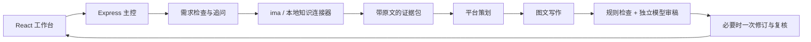

---
# 详细文档见https://modelscope.cn/docs/%E5%88%9B%E7%A9%BA%E9%97%B4%E5%8D%A1%E7%89%87
domain: #领域：cv/nlp/audio/multi-modal/AutoML
# - cv
tags: #自定义标签
-
datasets: #关联数据集
  evaluation:
  #- iic/ICDAR13_HCTR_Dataset
  test:
  #- iic/MTWI
  train:
  #- iic/SIBR
models: #关联模型
#- iic/ofa_ocr-recognition_general_base_zh

## 启动文件(若SDK为Gradio/Streamlit，默认为app.py, 若为Static HTML, 默认为index.html)
# deployspec:
#   entry_file: app.py
license: apache-2.0
---

# 知序 · 华为 PC 内容工作台

面向「AI+华为 PC 营销软文智能体」赛题的本地可运行 Demo。围绕产品、人群、场景和购买阶段，组织不同平台的图文内容，并展示事实依据、图片来源和核验结果。本作品是参赛演示项目，不是华为官方应用。

前后端分工开发请先阅读 [接口交接版本索引](docs/api/README.md)，其中可进入最新接口说明、模拟数据、流式事件处理和联调验收清单。每次项目任务新增归档版本，历史文档保留。

## 启动

需要 Node.js 22.12 或更高版本。进入项目目录后运行：

```powershell
npm install
npm run build
npm start
```

打开终端打印的本地地址，默认 http://127.0.0.1:3000 。Windows 也可双击 `start-demo.cmd`，脚本会检查依赖、构建并启动。开发模式使用 `npm run dev`。

**本地演示不需要任何 API Key。** 当前工作区自带的知识库用于读取真实产品事实和图片；生成器采用明确标识的规则引擎，不能将该模式作为真实模型或 ima 接入已完成的证明。

## 三种运行方式

| 方式 | 创作方式 | 产品资料 | 用途 |
| --- | --- | --- | --- |
| 本地演示 | 规则策略、规则成稿、规则初检 | 本地 P1 原文及图片索引 | 无密钥体验完整交互 |
| 模型创作 + 本地资料 | 模型策划、写作、独立审稿 | 本地 P1 原文及图片索引 | 调试模型与提示词 |
| 模型创作 + ima | 模型策划、写作、独立审稿 | 指定共享库的原文与图片 | 正式接入与比赛运行 |

模式不会在失败后静默切换。只有原文真正读取成功，才能进入证据包。`supported` 表示本次读取的原文支持该事实，不表示当前官网重新复核过该信息。所有本地结果显示来源警示，规则初检不等于模型语义审稿。

## 配置模型

复制 `.env.example` 为 `.env.local`，填写下面三个后端变量后重启服务：

```dotenv
LLM_BASE_URL=https://api.openai-next.com
LLM_MODEL=claude-opus-5
LLM_API_KEY=
```

模型标识按赛事提供的配置使用。后端使用该网关文档列出的 Anthropic Messages 协议：`POST /v1/messages`，`x-api-key` 和 `anthropic-version: 2023-06-01`。不依赖工具调用、思考参数或模型原生 JSON Schema；使用 JSON 提示词和 Zod 校验。仅显示响应的文本块，不显示模型思考内容。

每次任务包含一次策划、每个平台一次写作及一次独立审稿；双平台写作并行执行。出现错误或事实、图片、平台待改项时，最多一次定向修订并再次审稿。JSON 不合法时允许一次格式重试；限流或临时网关错误允许一次有限重试。模型使用原生 SSE 接收，只累计正文文本，不显示思考块；界面显示真实接收字符数。超时默认 180 秒，可配置 `LLM_TIMEOUT_MS`（最多300秒）。

**不要把密钥发送到聊天、前端、截图或仓库。** `.env.local` 已忽略。环境变量优先于配置文件；配置文件优先级为 `.env.local`、`.env`。

## 配置 ima

1. 使用自己的 ima 账号加入举办方指定共享库，确认客户端能够看到内容。
2. 从 ima 接口页面取得该账号的 Client ID 和 API Key，填写后端变量。
3. 保留完整的官方 `ima-skill`，统一脚本为 `ima-skill/ima_api.cjs`。本项目不会修改或上传共享库。
4. 重启服务，在工作台「连接设置」中点击验证。切换到 ima 模式重新生成，检查真实来源记录和图片。

```dotenv
IMA_OPENAPI_CLIENTID=
IMA_OPENAPI_APIKEY=
IMA_KB_NAME=任德耀新建华为PC知识库
IMA_ACCOUNT_LABEL=比赛演示账号
```

`IMA_ACCOUNT_LABEL` 是本地填写的显示别名，不是平台验证的真实账号身份。实际访问能力以接口读到指定库为准。后端支持官方配置文件和 `IMA_CLIENT_ID` / `IMA_API_KEY` 别名。

连接顺序：按完整名称定位库 → 搜索型号 → 搜索无结果时浏览目录 → 读取原文及图片索引。知识库 ID、媒体 ID、签名 URL、访问请求头和完整来源文档不会返回网页或包含在导出里。只读脚本的更新、权限、限流及原文不可读错误会明确反馈；缺图时保留缺口，不拿本地图冒充 ima 图片。

## 界面与功能

- 左侧设置型号、人群、场景、目标、购买阶段，选择最多两个平台。
- 中间切换图文预览和内容策略；两平台的结构、标题、语气、配图和行动引导分别组织。
- 点击事实引用，在右侧查看支持原文、限定条件、资料标题及来源。
- 右侧查看图片和核验；图片区分型号，规则识别无效引用、无依据数字、绝对化表述和未获支持的销售承诺。
- 支持临时修改、当前会话历史、标题备选、复制和 Markdown 导出。导出包含场景判断、知识库依据、图文软文、核验结果四部分。
- 本地规则修订支持精简、删除主题、强调有依据的主题、恢复主题与切换平台；自由改写需要模型模式。

平台图片规则独立于知识库模板，遵循赛题：公众号 2–4 张，小红书 3–6 张，朋友圈 1–3 张，门店海报 1 张且最多三个卖点。图片不足明确显示待补足状态。

## 架构



| 模块 | 入口 |
| --- | --- |
| HTTP / SSE / 会话 | `server/index.ts` |
| 流程编排 | `server/pipeline.ts` |
| 模型协议和重试 | `server/model.ts` |
| 三类系统提示词 | `server/prompts.ts` |
| 型号、原文、素材和 ima | `server/knowledge.ts` |
| 平台策略与规则审核 | `server/policies.ts` |
| 前后端数据协议 | `shared/types.ts` |

接口：`GET /api/status`、`GET /api/products`、`GET /api/sample`、`POST /api/generate`、`POST /api/revise`、`POST /api/connections/verify`、`GET /api/assets/:handle`。生成与修改返回 SSE，每个 `data` 是 `progress`、`result`、`needs_input` 或 `error` JSON。任务和原始证据仅保存在内存；闲置 30 分钟失效，重启清空。前端只持久化表单偏好。

## 验证与演示

本机已完成真实模型与 ima 接入验收，演示地址为 http://127.0.0.1:9753 。本机运行记录保存在 `output/demo/`，包括 `ACCEPTANCE.md`、`office-multiplatform.md` 和 `student-xiaohongshu.md`；这些记录包含知识库摘录，不随源码提交。案例保留实际审稿警示，待确认状态不等于发布通过。新环境请按上文配置资料与接口后重新生成。

```powershell
npm test
npm run check
npm run build
```

测试覆盖真实本地型号与图片绑定、CSV、目录穿越、ima 接口模拟合约、无权限/更新、JSON 与网关协议、四个平台差异、无依据价格、引用和数字、来源状态、修改与取消等。**ima 合约测试使用模拟脚本，不表示真实 ima 已经连通；模型协议测试使用模拟响应，不表示真实网关已经连通。**

建议现场演示：

1. 大学新生 × 开学购机 × 小红书/公众号，查看策略差异和原文依据。
2. 同型号改为职场人士 × 差旅办公，观察切入点与事实顺序。
3. 切换朋友圈/海报，展示不同结构、配图和 CTA。
4. 要求加入没有依据的补贴或亲测结果，查看未采纳说明。
5. 配置真实模型与 ima 后，重跑上述任务，录制真实检索、生成和核验过程。

## 本地资料与已知限制

本地根目录默认 `华为PC知识库/华为PC全板块深度知识库_v7`，也可通过 `LOCAL_KB_ROOT` 指定。项目只读取 P1 的核心 PC 型号，不自动引入培训资料、历史成稿、竞品或受控政策作为产品事实。共享知识库原始资料不会随代码公开；在新机器运行应由有权访问者放置资料或接入获授权的共享库。

没有本地库时，`server/catalog-seed.json` 只提供10个公开型号的目录元数据，不包含产品事实和图片。已配置模型与 ima 的新机器仍可按这些型号从指定共享库检索；本地生成会明确提示缺少资料。测试中需要随附本地库的实际集成项会有解释地跳过，其余模拟合约与规则测试仍可运行。

ima 原文目前支持 Markdown、文本、HTML 和账号有权限的笔记。PDF / Office 类型会明确提示当前适配器不支持，不猜测内容。图片必须有型号索引与成功读取的原图。部分型号素材不足时，小红书会显示数量警示。规则审核无法覆盖所有语义问题；模型模式会增加独立审稿，最终仍应处理待确认项。

首版为本地单账号演示，默认仅监听 `127.0.0.1`。不包含多用户鉴权、自动发布、在线协作、持久化数据库或浏览器图卡编辑。GitHub / 魔搭链接与运行视频需在真实接入验证后按赛题提交，不能用本地演示冒充在线核验结果。

公开依据：赛事中转站接入说明 https://credits.openai-next.com/guide/quickstart ，ima 配置 https://ima.qq.com/agent-interface 。
