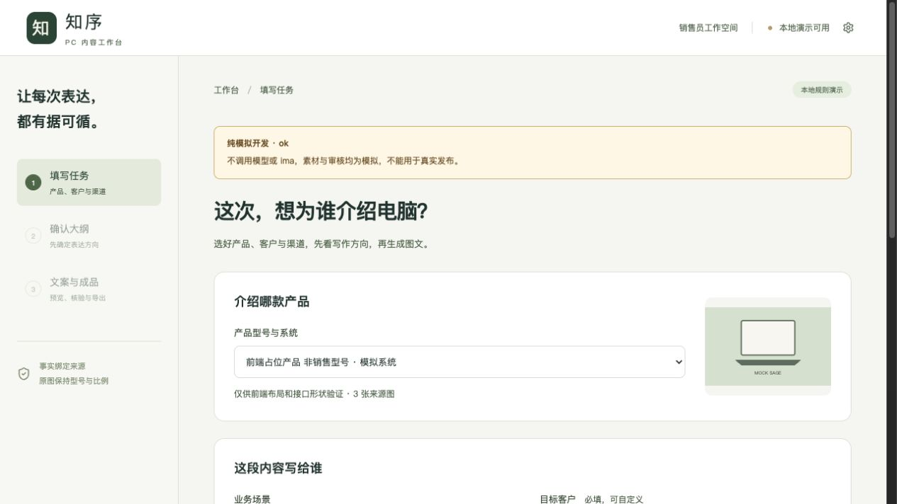
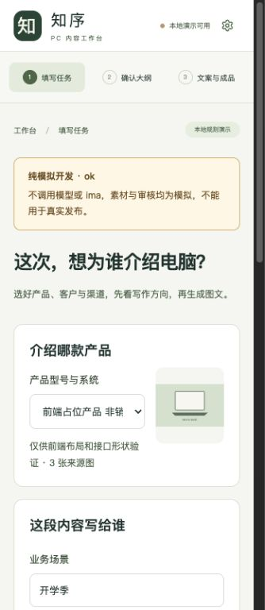

# 本地前端流程与协作实施交接

- 北京时间：2026-10-20T12:34:17+08:00；版本：2026-10-20-123417；上一归档：2026-10-18-171643。
- 任务：保留本地改动、合并后端最新进度、统一API/Mock、精简销售员三步流程、更新协作及PR模板、联调验收。
- 代码基线：17bd7c9262d584ba21795c0604eb993110a56038（frontend/workbench）；已合并origin/backend/api-handoff的5008332。本轮新增实现未提交、未推送；源码哈希记录工作区实际字节。
- 接口结论：**已核对，无接口变更**（相对上一归档）；沿用1–4渠道、大纲版本确认、HTTP响应和SSE事件。新增的ApiError/apiFetch是前端内部接口。另含macOS渲染运行时兼容修复。

## 交付与适配

- 日常入口「填写任务 → 确认大纲 → 文案与成品」，设置独立，更多要求与完整大纲编辑按需展开；保留保存/重新确认与审核门禁。
- 统一src/api调用层及完整工作流Mock；Mock不调用真实模型、ima或资源端点，且按需加载。异常场景、版本恢复、取消及受阻导出有回归。
- 当前协作策略见[本版策略](frontend-collaboration-strategy.md)，PR模板为[阅读快照](.github/PULL_REQUEST_TEMPLATE.md)；团队main集成基线是建议，本轮未操作远端。
- 本机已配置用户授权的本地资料目录，仅写被忽略配置；知识库、环境文件、缓存及真实产物不进入Git或容器构建上下文。新增docs/** -filter，保留-text，避免合并来的原始ZIP被LFS过滤器误当指针；没有改变ZIP或旧归档字节。

## 实际验证

- TypeScript检查、生产构建通过。主包279.60kB，Mock按需包416.06kB，无大小警告。
- 完整测试110通过，0失败、0跳过；其中23项前端API/SSE/Mock测试。测试在获授权本地资料可用时执行，不调用真实模型或ima。
- 首轮因缺Chromium失败；安装后发现macOS headless-shell ICU/GPU故障。采用官方支持的完整Chromium新无头模式后，两项针对测试及最终全量通过；没有忽略或删除失败测试。
- 浏览器Mock：四渠道任务→编辑并保存v2→确认→正文→公众号HTML+封面、小红书3页、朋友圈1拼图、海报1图；blocked仅预览、禁复制和下载。334px与1265px无横向溢出。
- 真实模型+本地证据：仅一条朋友圈完整HTTP链路，独立审核needs_attention，1张1080×1080PNG和ZIP实际可下载；正文仍含未证实咨询情境，不能当发布通过。见[脱敏验证摘要](verification/live-local-summary.json)。
- 没有调用ima；未重验其他人群/渠道的真实生成质量、微信编辑器粘贴、平台发布、云服务器或公开访问。Mock、规则测试、模型调用与ima验收分开记录。
- 设计检测0条；历史归档、首次原件、源码快照、相对链接与SHA-256校验结果见manifest。本轮未暂存，提交前仍须按暂存区字节复核。

[完整交接](frontend-handoff.md) · [请求样例](api-examples.http) · [纯模拟夹具](fixtures/frontend.mock.json) · [本轮检查](verification/local-checks.json) · [清单](manifest.json)

## 纯模拟页面截图

所有代码快照供阅读，不能视作独立可运行工程。旧归档与首次交接原件保持只读。
