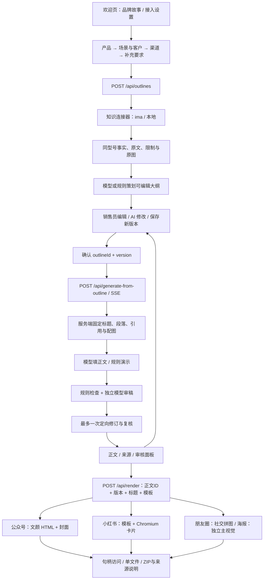

# 已实现架构：销售员任务到四渠道成品

当前为 React + Express 的单机 Demo，前端可由队友替换设计；后端、共享类型及分步协议已拆开。入口是 [接口交接索引](api/README.md)。

## 交互状态与确认边界

前端有七个步骤：接入、产品、场景与客户、渠道、要求、大纲、结果。操作者固定为销售员，audience 是销售员面向的客户。业务场景与渠道独立，每次支持1–4个不同渠道；结果页并排展示同一任务各渠道的标题、开场、段落功能、CTA与篇幅。

后端大纲状态为 editing → confirmed。每次手动保存或 AI 修改增加 version，确认失效。确认和正文生成都检查预期版本；过期 410、冲突或未确认 409。前端有未保存修改时禁止确认与生成，但真正的门禁在后端，不依赖按钮状态。

新正文绑定确认快照，生成途中修改大纲不会改变已经启动的任务。结果带 outline.id/version，正文另有自己的 id/revision；成品再绑定正文与标题索引。更改任务条件需要新大纲；更改模板仅重新排版。

旧 /api/generate、/api/revise 与 SSE 事件保留兼容，属于原有直接生成能力。新页面使用需要确认的大纲接口，不再调用旧接口跳过确认。

## 模块分工

| 目录/入口 | 责任 |
| --- | --- |
| src/WorkflowApp.tsx | 欢迎、步骤选择、大纲编辑/确认、正文/证据/审核与会话历史 |
| src/RenderPanel.tsx、src/api.ts | 成品预览/复制/下载、HTTP 与 SSE 客户端 |
| server/index.ts | 路由、运行状态、并发、取消、任务保留与错误处理 |
| server/connections.ts | 校验页面提交的配置，仅写后端进程内存，不回显密钥 |
| server/task-options.ts | 手册八类场景、建议人群、目标与渠道规格 |
| server/outlines.ts | 大纲检索/策划、引用校验、保存、乐观版本锁与确认快照 |
| server/pipeline.ts、server/prompts.ts | 原流程与确认大纲写作、规则/模型审稿和有限修订 |
| server/knowledge.ts、server/model.ts | 既有 ima/本地知识连接器与 Messages 模型协议 |
| server/policies.ts | 平台策略、型号/事实/营销表达与图片规则 |
| server/channels.ts | 各渠道策划与写作要求、排除完整产品事实后的叙事框架重合度提示 |
| server/render/compositions.ts | 公众号编辑封面、朋友圈社交图卡、海报主视觉的独立构图树 |
| server/render/ | 受控模板、原图解析、HTML/PNG、成品句柄、ZIP、过期清理与许可 |
| shared/types.ts、server/schemas.ts | 共同类型与输入约束；变更必须进入新交接版本 |

后端负责人主要维护 server/，前端队友主要维护 src/。共享类型、输入校验和接口行为以同一次交接归档为基准。代码快照供阅读，正式开发从完整工程运行。

## 数据与外部调用

模型接收当前任务、所选型号事实及必要限制、图片名称/说明，不发送设备图二进制或完整知识库。原文中的指令作为资料，不作为系统要求。图片通过已有服务器句柄读取并等比合成，渲染不访问外部图像生成服务。

原文与凭证不写入交接归档。页面配置、任务与大纲均为进程内存；成品仅写 .cache/render/，最多 20 组，30 分钟失效。事实、图片与资料对外使用本系统标识，不返回 ima 内部 KB/media ID 或签名链接。导出说明映射为可读名称，不含原始全文。

审核阻断仅供带标记预览；待确认结果保留标记与问题。公众号图尚未转存微信，自动发布、印刷 PDF、多账号、协同数据库和在线图层编辑不在当前实现内。

渠道差异贯穿大纲、写作、审核与渲染：公众号分析决策，小红书行动清单，朋友圈单看点交流，海报简洁主视觉。小红书使用明亮封面、编号清单与深色互动尾页；朋友圈把1–3张原图合成一张社交图卡，海报使用一张原图和独立卖点槽。共用事实保持一致；标题、开场、段落标题与CTA过于接近时标记渠道警告并进入既有一次修订。相似度是启发式提示，不是语义原创度证明。任意类别的审核error均阻断导出，模型不能清除硬规则错误。

## 本机接口与渲染边界

入口先核对 Host，再对写入请求核对 Origin 的协议、主机与端口及跨站标志，最后解析 JSON。独立 Vite 前端使用相对 /api 和保留 Host 的开发代理。未配置鉴权，当前仍以单操作者本机使用为范围。

取消信号传递到模型、知识连接器和渲染；并发计数与配置锁直到实际异步任务退出才释放。模型请求捕获本次凭证供有限重试，非流响应在读取中限制大小。错误不回显枚举输入、未知字段名、密钥或本地路径。

公众号使用文颜 public core 与无脚本/外部资源的 JSDOM 排版，图片在文本处理后嵌入。小红书由受控模板一次填充，保留文案中的替换字符原文；下层图像布局仅接受嵌入式 PNG。前端校验 SSE 的完整结果与确认大纲绑定，成品校验任务/版本/渠道/标题/模板绑定，过期后要求重新排版。
