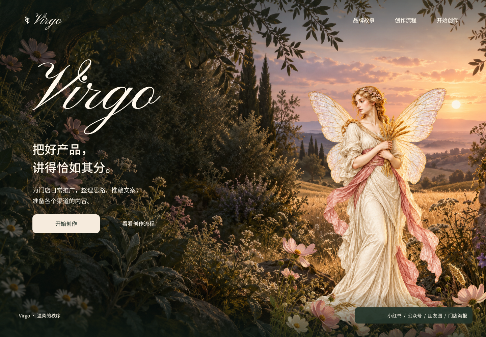
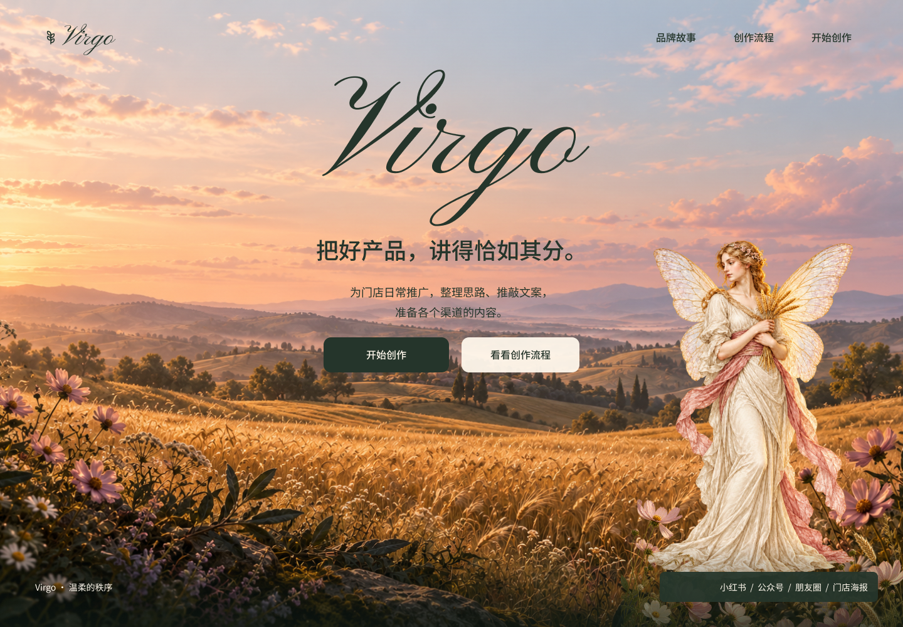

# Virgo 首页第二轮：花园与晚风

本轮交付是 **两张可比较的静态首页构图**，用于确定下一轮主视觉。两版已写入现有 Figma Design 文件，文字、导航和按钮保持原生可编辑，风景、仙女与前景花草独立分层。没有把合成预览图作为整个网页背景贴回 Figma。

当前阶段先比较 A/B 构图；选择方向后再制作背景循环视频与轻微鼠标景深。网站、工作页面和手机新首页尚未按本轮风格实现。

## 直接查看

| 候选 | 设计画板 | 可点击预览 | 本地最终截图 |
| --- | --- | --- | --- |
| A · 花园之门 | [Figma A](https://www.figma.com/design/JfR3uVD884firgx27czG8M?node-id=39-2922) | [原型 A](https://www.figma.com/proto/JfR3uVD884firgx27czG8M?page-id=4%3A4&node-id=39-2922&starting-point-node-id=39%3A2922) | [home-a.png](previews/home-a.png) |
| B · 晚风中的麦田 | [Figma B](https://www.figma.com/design/JfR3uVD884firgx27czG8M?node-id=39-2967) | [原型 B](https://www.figma.com/proto/JfR3uVD884firgx27czG8M?page-id=4%3A4&node-id=39-2967&starting-point-node-id=39%3A2967) | [home-b.png](previews/home-b.png) |

两张画板均为 1440 × 1000，位于 Desktop & States 页面（`4:4`）下方，未替换第一轮主流程或删除原有画板。

### A · 花园之门

近处的暗色枝叶构成入口，远处的晚霞麦田带来纵深。左侧集中呈现字标、标语、门店用途和开始创作，右侧仙女与晚霞呼应。通过花草轻微遮挡裙摆、接触阴影和暖色边缘，使人物进入风景。

A 更接近用户新参考中的“暗处花园望向明亮世界”，文字阅读组也更集中。

### B · 晚风中的麦田

打开天空和地平线，以居中的花体字标作为主要识别。仙女缩小并移向右侧，前景只保留底边与角落花草。整体更明亮、开阔，保留金色麦田、雾蓝远山与低饱和粉霞。

B 的次入口增加暖白阅读底，两版右下渠道说明增加局部深橄榄阅读底，避免照片明暗影响文字。

## 本轮已经落实的设计决定

- 品牌只叫 **Virgo**；核心为“温柔的秩序”；标语为“把好产品，讲得恰如其分。”
- 全景环境取代旧封面大面积乳白圆润外壳；旧稿作为第一轮基线保留。
- 主角为手持麦穗的成年仙女，延续原品牌插画身份。新透明版本与原文件分别保存。
- 字标使用 **Pinyon Script Regular**，形成古典连笔和粗细反差；中文使用 **Noto Sans SC**。
- 仙女、文字和前景花草分别成层，后续可以试验轻微的 2.5D 视差；当前没有实际鼠标响应。
- 首页直接说明门店日常推广用途，并提供“开始创作”。
- 操作页面未来沿奶油白底与低饱和粉、蓝、绿、紫展开；本轮没有宣称工作台已完成改版。

新增四个场景色角色：暖白 `#FFF8EC`、深橄榄 `#25352B`、奶油 `#F6EBDD`、灰玫瑰 `#D9B7C4`。在既有变量系统中建立 primitive 与 semantic alias，并新增花体文字样式、明暗字标组件及透明人物/花草组件，避免为两张稿另建整套不兼容组件库。

已有辅助文字 Muted 已读回确认是 `#78616D`，第一轮的 `#806975` 对比度问题不能再作为“尚未修复”的现状描述。这个色值修复不等于所有照片背景上的文字都已完成 WCAG 验收。

## 原型与编辑方式

- 顶部“品牌故事”和“创作流程”打开原生弹层，均有返回操作。
- 两版“开始创作”连接既有需求页 `6:121`，以便理解产品用途。该页仍为第一轮工作台风格。
- 新的两个原型起点与旧流程起点并存。
- 界面相关子元素采用 Auto Layout；背景、人物、前景和阅读遮罩按构图定位。
- 大字标仍是文字层，不是转曲路径。实际查看或继续编辑需要可用字体；本轮未将字体文件打包进仓库。
- 交互只是 Figma 设计演示，没有真实调用生成、审核、复制、下载或模型接口。

节点与来源见 [figma-map.json](figma-map.json)；核对结果见 [verification.json](verification.json)。

## 资产与复现资料

| 文件 | 用途 | 格式与实际尺寸 |
| --- | --- | --- |
| [garden-gate-background.png](assets/garden-gate-background.png) | A 的完整远景 | RGB，1586 × 992 |
| [evening-wheat-background.png](assets/evening-wheat-background.png) | B 的完整远景 | RGB，1586 × 992 |
| [virgo-fairy-cutout.png](assets/virgo-fairy-cutout.png) | 两版共用的独立仙女 | RGBA，1086 × 1448，含真实透明区域 |
| [foreground-botanicals.png](assets/foreground-botanicals.png) | 花草近景与裙摆遮挡 | RGBA，1536 × 1024，含真实透明区域 |

使用内置 image_gen 工具制作，不把用户参考网站的截图直接作为成品素材。模型名称未由工具返回，不作推断。原有 [仙女原图](../../assets/virgo-fairy-hero.png)保留不变。这些是品牌场景素材，不是产品图片或已核验的华为产品资料。

[提示词与复现约束](prompts.json)明确区分保留的实际提示词和整理后的复现版本；[provenance.json](assets/provenance.json)记录生成方式、文件尺寸、透明范围及 SHA-256。未在交接中记录用户私人参考图路径、账号信息或临时素材访问地址。

## 已完成核对与下一阶段

已查看两张最终 Figma 导出的 1440 × 1000 截图，并完成独立视觉复核。每张稿有 11 个可编辑文字节点、3 个图片图层；所有文字框均位于画板内，字体为 Pinyon Script / Noto Sans SC。已检查首页的 5 个点击动作、弹层关闭动作和两个新增原型起点；未完整人工点击整条旧流程。

两处可读性问题已按复核意见修复并重新导出。没有因为只检查静态截图就声称动画、响应式、可访问性或产品业务验收全部完成。

后续顺序：
1. 用户比较 A/B，并确定保留的构图与气氛。
2. 为选定方向补充适合轻微视差的边缘出血、背景视频和静态后备图；检查人物、地面、前景移动时的接缝。
3. 试做轻微、可关闭的鼠标视差；视频与界面分别处理，按钮保持即时可用。
4. 完成手机构图与减少动态版本，再将一致的字体、色彩和品牌细节带入工作页面。

本轮没有应用代码或接口变更，没有运行应用测试、营销文案模型或 ima 联调；原有业务约束继续以[固定接口入口](../../../../api/README.md)为准。设计归档不等于 Git 提交或推送。

