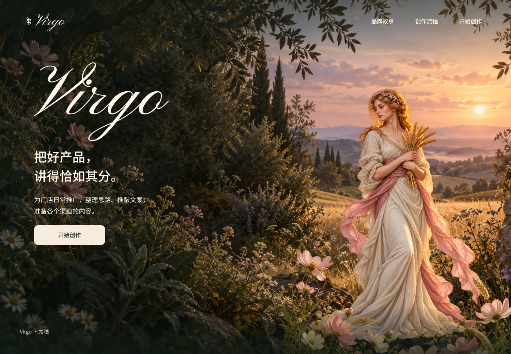

# Virgo A3 · 拾穗精简封面

本轮按已确认方案，基于 A2 制作无翼、精简入口的新封面。原 A2 及此前 A/B 保留不变，当前最新稿为 A3。

[查看 Figma](https://www.figma.com/design/JfR3uVD884firgx27czG8M?node-id=54-2841) · [打开原型](https://www.figma.com/proto/JfR3uVD884firgx27czG8M?page-id=4%3A4&node-id=54-2841&starting-point-node-id=54%3A2841) · [原 A2 对照](../2026-10-21-fairy-fusion/README.md)

## 已完成修改

- 去掉翅膀，直接复用现有无翼持麦人物。人物位置 835 / 245、尺寸 540 × 720、整体不透明度 1；受光、贴地阴影和前景花草遮挡均沿用 A2。
- 左下角显示 **Virgo · 拾穗**，字体和位置不变。这是页脚文案修改，品牌主字标仍为 Virgo。
- 删除主“开始创作”右侧的“看看创作流程”，包括它的点击区域。
- 删除右下绿色阅读底及渠道文字，露出原来的花草和裙摆。
- 顶部品牌故事、创作流程与开始创作保留，其余字标、标语、说明、背景及布局沿用 A2。

## 交付与复用

| 对象 | 数据 |
| --- | --- |
| A3 画板 | `54:2841`，Page `4:4`，1440 × 1000 |
| 独立无翼组件 | `53:2841`，480 × 640，仅包含身体图层 |
| 身体图层 | `53:2843`，图片沿用 A2 身体哈希 |
| 首页人物实例 | `54:2846`，不包含翼膜图层 |
| 页脚 | `54:2865`，Virgo · 拾穗 |

[无翼透明素材](assets/figure-no-wings.png)为 RGBA、1086 × 1448，与 A2 的 [fairy-body.png](../2026-10-21-fairy-fusion/assets/fairy-body.png)字节完全相同。本轮没有重新生成或修改图片像素，也没有新增字体、色彩变量或后端能力。

[节点账本](figma-map.json)、[验证记录](verification.json)及[素材来源与哈希](assets/provenance.json)保存本次实际交付信息。

## 检查结果

最终完整首页截图已查看，并获得独立视觉复核的可交付结论。四项修改均已完成，未发现必须修正的视觉问题。

结构读取确认：
- 当前人物实例仅包含原身体图片，翼膜图片与图层均不存在。
- 新稿的二级入口、文字子节点、右下底块和渠道文字均已实际删除，无隐藏点击区遗留。
- 保留 9 个可编辑文字节点；按指定删除与页脚替换后，其字体和相对边界与 A2 一致，全部位于画板内。
- 剩余 4 个点击动作指向有效的品牌故事、流程说明或需求页；A3 原型起点存在，主“开始创作”仍到需求页 `6:121`。
- A2 全树与本轮开始时的基线读取一致，旧稿没有被本次修改覆盖。

上述为图层、动作配置和静态视觉检查，未完整人工点通原型，不代表真实业务调用成功。没有运行应用测试、构建、营销文案模型或 ima 联调。本轮无网站源码、后端或接口变更，协议仍以[固定接口入口](../../../../api/README.md)为准。

本轮仍为静态封面设计。循环视频、鼠标景深、新手机构图和工作台改版尚未制作；交接归档不等于 Git 提交或推送。

