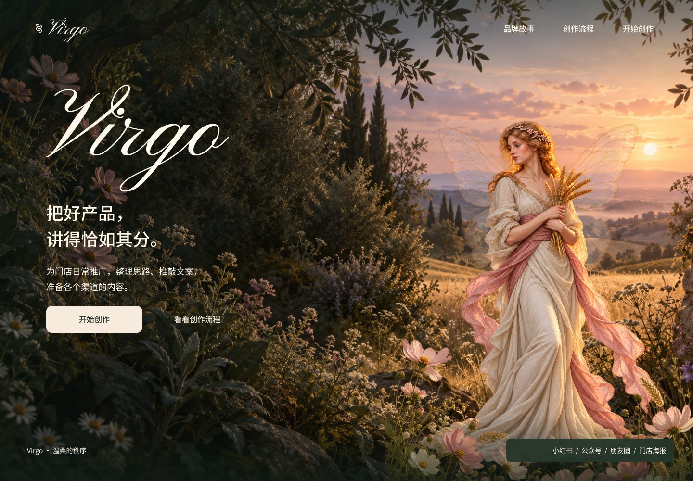

# Virgo A2 · 花园之门仙女融合修订

用户已选定 A「花园之门」，并确认仙女采用**自然电影感**。本轮完成同一构图中的人物融合修订，保留原 A、B 和第一轮工作流程。

[查看 Figma 修订版](https://www.figma.com/design/JfR3uVD884firgx27czG8M?node-id=47-2823) · [打开点击原型](https://www.figma.com/proto/JfR3uVD884firgx27czG8M?page-id=4%3A4&node-id=47-2823&starting-point-node-id=47%3A2823) · [原 A 对照](../2026-10-20/previews/home-a.png)

## 本轮变化

- 人物正面转入柔和阴影，右后方晚霞照亮头发和衣裙轮廓；布料从雕刻般的装饰纹理转向自然衣褶。
- 翅膀与身体拆成独立图层，翼膜单独透光，晚霞与远山可以透过；没有降低整个人物的不透明度。
- 保留持麦姿势、长裙和人物区域，裙摆继续被前景花草局部遮挡，调整贴地阴影使其与地面衔接。
- 字标、标语、用途说明、导航和操作区保持原 A 的内容、字体和相对几何。Figma 原 A/B 及旧共用仙女组件均未改动。

本轮仍为静态设计，没有开始背景循环视频、鼠标景深、新手机构图或工作台重做，也没有将设计实现到网站。

## 图层与可复现数据

| 对象 | 节点与数据 |
| --- | --- |
| A2 画板 | `47:2823`，Page `4:4`，1440 × 1000 |
| A2 专用仙女组件 | `46:143`，480 × 640 |
| 翅膀层 | `49:143`，位置 54 / 6，尺寸 391.2 × 521.6，不透明度 0.28 |
| 身体与衣裙层 | `49:144`，位置 0 / 0，尺寸 480 × 640，不透明度 1 |
| 首页人物实例 | `47:2828`，位置 835 / 245，尺寸 540 × 720，整体不透明度 1 |
| 组合导出实例 | `49:145`，1086 × 1448，透明背景 |
| 原 A / B / 旧人物组件 | `39:2922` / `39:2967` / `37:162`，均保留 |

背景与近景花草沿用原素材。界面仍是原生文字、组件与 Auto Layout；完整预览没有作为整张 UI 图片导回画板。人物组件内部的图片约束保持比例，便于之后按当前实例尺寸使用。

单图改画仍让翼膜显得偏实，因此最终使用两张独立透明素材在 Figma 内合成。翅膀单独 28%，身体图层 100%；组合 PNG 的抽样 alpha 为翼膜 71、衣裙 253、空白 0。衣裙采样值来自生成源图，并非将整个人物图层设为半透明。

## 交付素材

- [fairy-fusion.png](assets/fairy-fusion.png)：最终独立仙女组合 PNG，RGBA，1086 × 1448，保留真实透光翼膜与透明外部。
- [fairy-body.png](assets/fairy-body.png)：身体与衣裙，独立透明图层。
- [fairy-wings.png](assets/fairy-wings.png)：翼膜原图；后续使用须沿用上表的缩放、位置和 28% 不透明度，不能直接把整张翼膜原图当最终效果。
- [fairy-cinematic-source.png](assets/fairy-cinematic-source.png)：电影感改画的制作参考，不是最终透光组合。
- [完整首页预览](previews/home-a-fusion.png)。
- [实际提示词与生成过程](prompts.json)、[资产来源与 SHA-256](assets/provenance.json)、[Figma 节点账本](figma-map.json)、[验证记录](verification.json)。

使用内置 image_gen 共 4 次，包括未采用的单图翼膜调整；模型名未由工具返回，不作推断。最终组合由 Figma 原生分层导出，Python 仅用于复制、尺寸、透明度与哈希检查，没有修改图片像素。素材为 Virgo 品牌插画，不是产品图片或产品事实证据。

## 核对结果

已查看最终完整首页和透明人物资产，并获得独立视觉复核的可交付结论：人物受光与花园更协调，翅膀透出背景，裙摆落地更自然；正常页面尺寸下未发现明显切边或拼贴问题。

结构核对确认：
- 11 个可编辑文字节点全部在画板范围内，内容、字体与相对边界和原 A 完全一致。
- 5 个点击动作仍指向有效需求页或品牌故事／创作流程弹层，新增 A2 原型起点存在。
- 原 A、B 的图层、文字和动作配置与本轮开始时一致，旧仙女组件仍使用原图片哈希。
- 最终组合 PNG 为 RGBA、1086 × 1448；首页预览为 1440 × 1000。

未完整人工点击原型，不将以上结构核对当成业务生成、剪贴板或下载成功。没有运行应用测试、构建、营销文案模型或 ima 业务联调。本轮无网站源码、后端或接口修改，业务约束继续以[固定接口入口](../../../../api/README.md)为准。

下一阶段可基于选定的 A2 继续讨论循环视频与轻微鼠标景深；本轮静态修订不代表这些动效已经实现。

